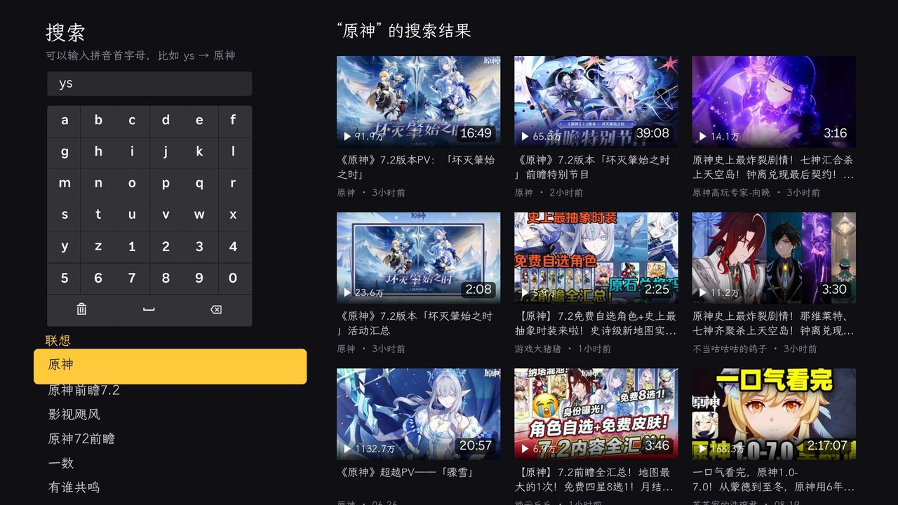
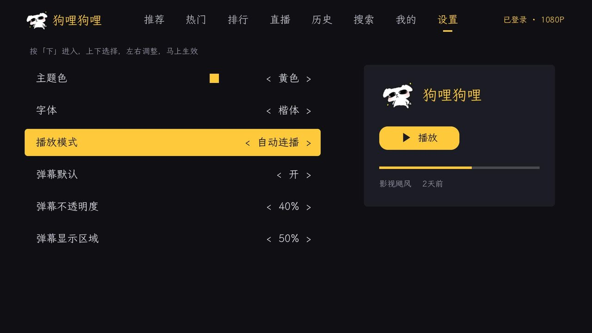

# 狗哩狗哩 —— Roku 上的 B 站客户端

中文 | [English](README.en.md)

在 Roku 电视上直接看 B 站。**App 完全在电视上独立运行**，不需要电脑或服务器一直开着；电脑只在第一次安装和以后更新时用一下。

- 首页：推荐、热门、排行，每个视频都显示发布时间
- 直播：登录后你关注的主播开播了会排在最前面，可以切换画质
- 搜索，支持拼音首字母联想（输入 `ys` 会联想出「原神」）
- 扫码登录，登录后最高 1080P
- 我的：账号信息和收藏夹
- 观看历史，可以在电视上删除
- 弹幕，可以开关、调不透明度
- 观看进度和 B 站账号互相同步：电视上看到哪里，手机上接着看；手机上看到一半，电视上接着看
- 分 P 视频选集、相关推荐、断点续播
- 主题色（黄 / 粉 / 蓝 / 绿 / 紫）和字体（楷体 / 黑体 / 宋体）可以在设置里换

## 截图

| 首页 | 视频详情 |
| --- | --- |
|  |  |
| **搜索（拼音联想）** | **设置（主题色、字体、弹幕）** |
|  |  |

> **非官方项目**，与哔哩哔哩（上海宽娱数码科技有限公司）没有任何关系，仅供个人学习和自用。使用你自己的 B 站账号，请遵守 B 站用户协议，不要用于商业用途。

## 安装

需要一台 Roku 电视或 Roku 播放器，以及一台和它连在同一个 Wi-Fi 下的电脑（macOS 或 Linux）。

1. **打开电视的开发者模式**：用遥控器依次按 Home ×3、上 ×2、右、左、右、左、右，按屏幕提示开启，并设置一个开发者密码。屏幕上会显示电视的 IP 地址。
2. **下载这个项目**，在项目目录里填好电视信息：

   ```bash
   cp .env.example .env.local
   ```

   然后打开 `.env.local`，把 `ROKU_IP` 改成电视的 IP 地址，`ROKU_PASS` 改成刚才设的开发者密码。
3. **安装到电视**：

   ```bash
   scripts/deploy.sh
   ```

   装好后 App 会自动打开，以后在 Roku 主屏幕上也能找到「狗哩狗哩」。之后更新代码，再运行一次这条命令即可。

## 使用

### 首页的标签

| 标签 | 内容 |
| --- | --- |
| 推荐 | B 站首页推荐，登录后是你的个性化推荐；在标签上按 OK 换一批 |
| 热门 | 当下正在火的视频，更新很快，可以一直往下翻 |
| 排行 | 全站排行榜：最近几天综合表现最好的 100 个视频，大约每天更新 |
| 直播 | 正在直播的直播间，按人气排序；登录后你关注的主播排在最前面 |
| 历史 | 你的观看历史，显示看到哪里 |
| 搜索 | 按 OK 打开搜索 |
| 我的 | 未登录时显示登录二维码；登录后上面是账号信息，下面是收藏夹，点开收藏夹看里面的视频 |
| 设置 | 主题色、字体、弹幕默认开关和不透明度，按「下」进入后直接调整 |

### 遥控器

| 位置 | 操作 |
| --- | --- |
| 标签栏 | 左右切换标签，按「下」进入内容 |
| 视频列表 | 往下翻会自动加载更多；按「上」或返回键回到标签栏；`*` 刷新 |
| 历史 | 在某个视频上按 `*`：从观看历史中删除这一条，或清空全部 |
| 我的 | 按 `*`：刷新，或退出登录 |
| 设置 | 上下选择，左右调整，马上生效 |
| 视频详情 | 按「下」看相关推荐，按「右」选集 |
| 播放 | **OK 暂停 / 继续**，左右快进快退，**「下」打开弹幕设置**，「上」显示标题，返回键退出（自动记住进度） |
| 看直播 | 按「下」切换画质，「上」或 OK 显示标题，返回键退出 |
| 搜索 | 用屏幕键盘输入，可以输拼音首字母 |

删除、清空历史和退出登录都会再确认一次，默认选中「取消」。

### 登录

打开「我的」，用 B 站手机客户端扫屏幕上的二维码，在手机上点确认。未登录时最高 720P，登录后最高 1080P。登录信息只保存在这台电视上。

登录后，观看进度会和 B 站账号同步：电视上看的视频会出现在手机的历史记录里；打开一个电视上没看过、但在别的设备看到一半的视频，会从那里接着播。

## 字体

界面字体使用霞鹜文楷、Noto Sans SC 和思源宋体的子集，均按 SIL Open Font License 1.1 授权，许可证见 [`channel/fonts/`](channel/fonts/)。
